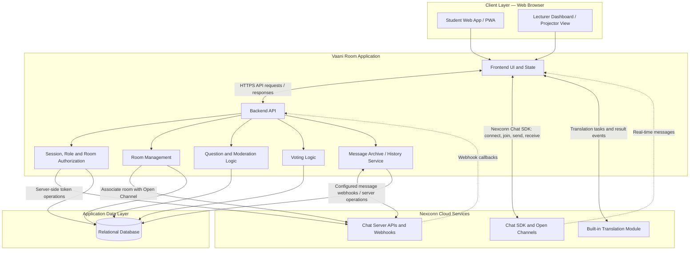
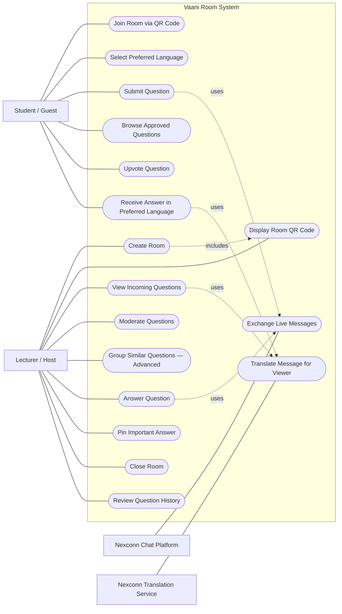
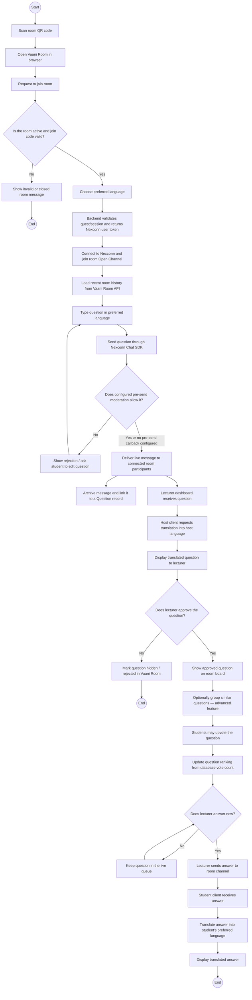
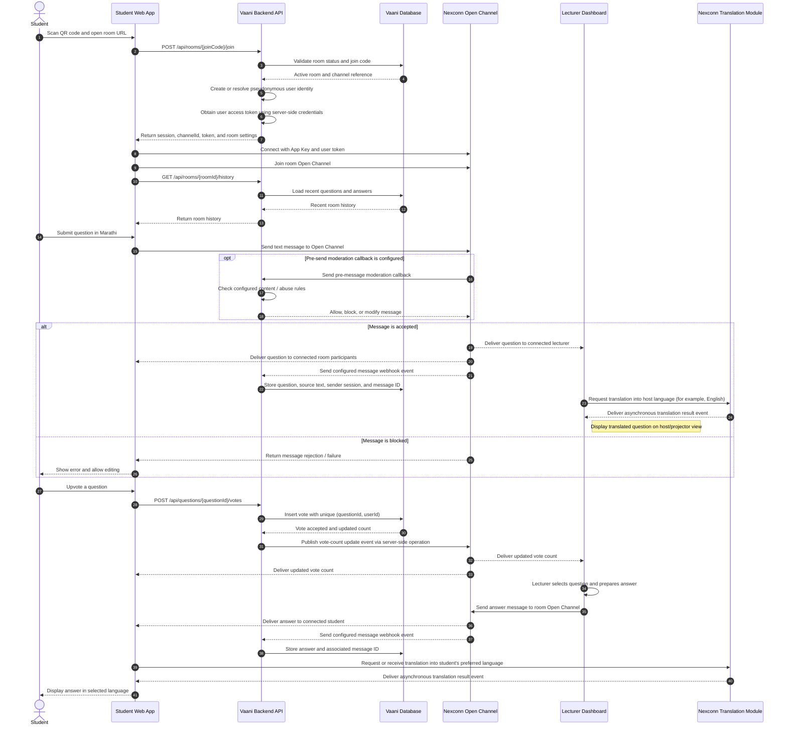
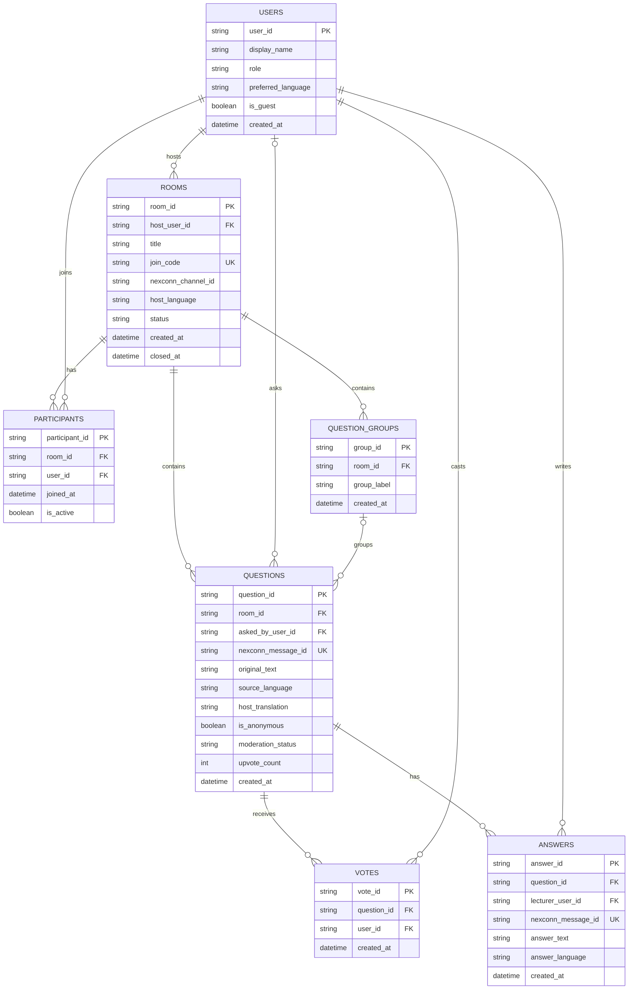
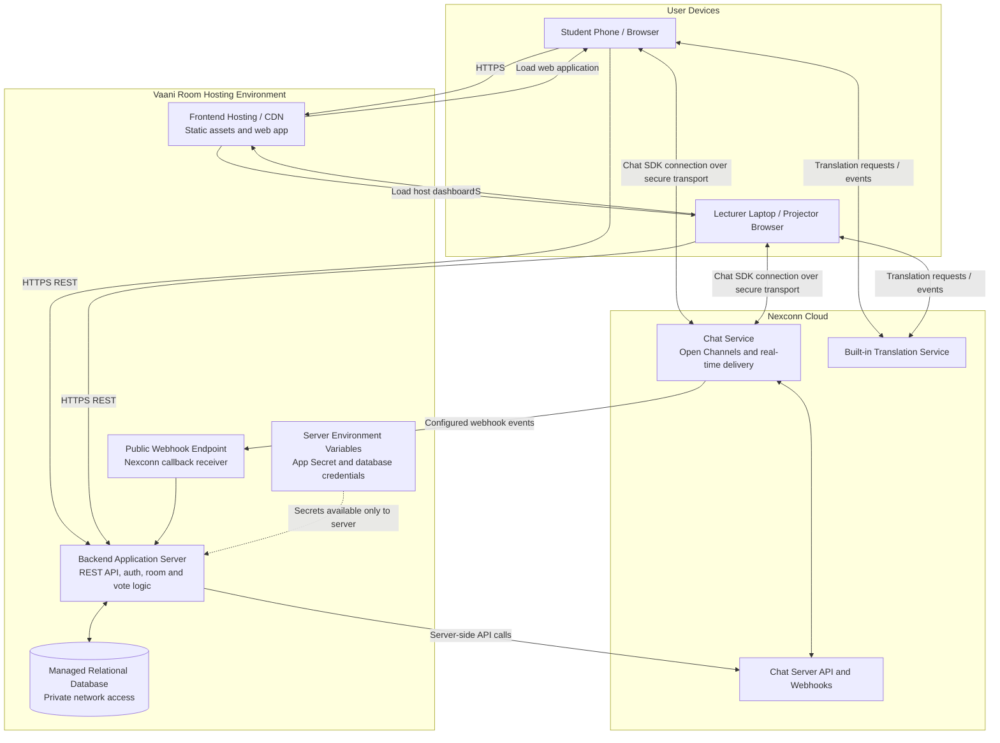

# Vaani Room — System Architecture

> **Document status:** Proposed design (v0.1)  
> **Purpose:** Describe the product's main actors, workflows, components, data model, and deployment shape.  
> **Product:** A multilingual live Q&A web app for classrooms and events, built around the Nexconn Chat SDK.

---

## Contents

1. [Project overview](#1-project-overview)
2. [Design decisions and assumptions](#2-design-decisions-and-assumptions)
3. [High-level architecture](#3-high-level-architecture)
4. [Use case diagram](#4-use-case-diagram)
5. [Activity diagram — student asks a question](#5-activity-diagram--student-asks-a-question)
6. [Sequence diagram — question, voting, and answer](#6-sequence-diagram--question-voting-and-answer)
7. [Entity relationship diagram](#7-entity-relationship-diagram)
8. [Deployment diagram](#8-deployment-diagram)
9. [Key API responsibilities](#9-key-api-responsibilities)
10. [Security, reliability, and implementation notes](#10-security-reliability-and-implementation-notes)
11. [Suggested implementation order](#11-suggested-implementation-order)

---

## 1. Project overview

### Problem

Students may hesitate to ask questions in a classroom or event because they are not comfortable writing or speaking in the lecturer's language. Questions can also be repeated, difficult to moderate, or lost during a live session.

### Proposed solution

Vaani Room lets a host create a live Q&A room and share a QR code. Students join from a browser, choose their preferred language, and submit questions. The lecturer sees questions in the host's language, can moderate and answer them, and students can receive answers in their selected languages.

### Main user journey

1. Lecturer creates a room and displays its QR code.
2. Student scans the QR code and joins from a browser.
3. Student chooses a preferred language.
4. Student submits a question in that language.
5. The question is delivered live; the lecturer views it in the host language using Nexconn's translation capability.
6. Students upvote questions. The application stores votes and enforces one vote per student session per question.
7. Lecturer answers the question.
8. Students view the answer in their preferred languages using Nexconn's translation capability.

### Project goals

- No app installation required for students.
- A fast QR-based joining experience.
- Real-time question and answer delivery using Nexconn Chat SDK.
- A useful host moderation and upvoting workflow.
- Multilingual question and answer viewing.
- A persistent application-side record of rooms, questions, votes, and answers.

---

## 2. Design decisions and assumptions

These diagrams describe a **proposed implementation**, not features that have already been built or tested.

| Area | Current design assumption |
|---|---|
| Client | Browser-based responsive web app or PWA. Student and host experiences can be separate routes in one frontend. |
| Backend | A server-side API handles room management, authorization, votes, moderation state, and Nexconn server operations. |
| Real-time messaging | Use a Nexconn **Open Channel** for each live room, subject to the account's plan limits and console configuration. |
| Translation | Use Nexconn's built-in Chat SDK translation module. Set the host's target language to the lecturer's language and each student's target language to their preference. |
| Database | Use a relational database as the source of truth for application records, especially votes and moderation status. |
| Anonymous questions | Allow a guest/pseudonymous session. Hide the student's identity in the host UI when anonymous mode is selected, but retain a stable internal session ID for vote deduplication and abuse controls. |
| Similar-question grouping | Advanced feature. Keep it out of the minimum viable flow until QR joining, live messaging, translation, moderation, voting, and answers work reliably. |
| Offline behavior | Open Channels do not deliver offline messages. On rejoin, load the room's recent question and answer history from the Vaani Room database/API. |

### Important Nexconn implementation constraints

- Nexconn requires a valid user access token to connect. The application server obtains/issues the token; the browser must not contain the Nexconn App Secret.
- The Nexconn App Key is used by the client SDK. The App Secret is only for server-side API authentication.
- Open Channels are designed for high-throughput live broadcasts and have no member limit, but users receive messages only while they are active in the channel. Open Channels do not support offline message delivery or push notifications. The current Nexconn glossary lists a Free-plan limit of 50 concurrent Open Channels; verify the limit for the plan used by the team.
- Open Channel cloud retention is disabled by default in the current documentation. Vaani Room should archive its own room history in its database, for example through configured message webhooks or a server-side persistence flow.
- Nexconn's built-in translation is disabled by default and must be enabled in the Nexconn Console. Translation tasks are asynchronous; the app must handle translation result events. Translation is billed separately, subject to the plan's allowance.
- Nexconn documents message metadata/extensions, but votes should still be stored as individual database records so the application can enforce uniqueness and calculate reliable counts.

Check the latest Nexconn documentation and your actual plan/Console configuration before relying on any limit or feature in production.

---

## 3. High-level architecture

This diagram shows the main application components and their responsibilities.

### Component responsibilities

| Component | Responsibility |
|---|---|
| Student Web App | Join by QR, choose language, submit questions, browse questions, vote, and receive answers. |
| Lecturer Dashboard | Create rooms, display QR codes, view translated questions, moderate, answer, pin, and close rooms. |
| Backend API | Validate sessions and permissions; manage rooms; process votes and moderation; perform privileged Nexconn operations. |
| Nexconn Chat SDK / Open Channel | Real-time message transport between connected students and the host. |
| Nexconn Translation Module | Translate message text into each viewer's configured target language and emit translation results. |
| Relational Database | Store rooms, participants, questions, votes, answers, and moderation state. |
| Message Archive / History Service | Persist message events and provide recent history when a participant joins or reconnects. |

---

## 4. Use case diagram

A use case diagram answers: **What can each actor do with Vaani Room?**

> **Mermaid limitation:** Mermaid does not currently provide a dedicated UML use-case diagram syntax. The flowchart below is a GitHub-renderable approximation. It uses rounded nodes for use cases and a subgraph for the system boundary. For a strict UML submission, recreate this model in Visual Paradigm or diagrams.net using UML actor figures and ellipses.

### Actors

- **Student / Guest:** Joins a room and participates in Q&A. The student may use a pseudonymous session.
- **Lecturer / Host:** Creates and controls the room, moderates questions, and answers them.
- **Nexconn Chat Platform:** External real-time messaging platform used by the application.
- **Nexconn Translation Service:** External translation capability used by the Chat SDK.

### MVP versus advanced use cases

**MVP:** Join room, select language, submit question, view questions, moderate, upvote, answer, receive translated answer, close room, and view history.

**Advanced:** Similar-question grouping, analytics, export, and richer moderation workflows.

---

## 5. Activity diagram — student asks a question

An activity diagram answers: **What steps and decisions occur in a particular workflow?** This diagram follows a student from scanning the QR code to receiving the lecturer's answer.

### Important workflow behavior

- A room can reject new joins after it is closed.
- A student should receive a clear error if connection or message sending fails.
- The pre-send moderation callback is optional and must be configured in Nexconn Console. Lecturer moderation is a separate application feature.
- Open Channel messages are live delivery, not an offline inbox. History must be retrieved from Vaani Room's own backend when the student rejoins.
- Similar-question grouping is optional and should not block the first working end-to-end demo.

---

## 6. Sequence diagram — question, voting, and answer

A sequence diagram answers: **Which component talks to which other component, and in what order?**

This sequence assumes a room already exists. It includes joining, asking a question, translating it for the lecturer, voting, answering, and translating the answer for the student.

### Notes on the sequence

- The browser receives a user-specific access token from the backend. It must never receive the App Secret.
- Nexconn's built-in translation is asynchronous. The UI should show a translating/loading state and handle translation failure without losing the original message.
- The lecturer's target language and each student's target language are individual preferences. A lecturer may use English while a student uses Marathi, Hindi, Gujarati, Tamil, or another supported language.
- The vote endpoint is handled by Vaani Room, not trusted to arbitrary client-side counters. A database uniqueness constraint prevents repeat votes from the same session.
- The message webhook is a configured integration. If the team uses a different persistence path, update this diagram to match the implementation.

---

## 7. Entity relationship diagram

The ER diagram answers: **What data does Vaani Room store, and how are records related?**

The relational database is the source of truth for application-specific data. Nexconn transports messages; Vaani Room stores the room, vote, moderation, and application history records it needs.

### Entity descriptions

| Entity | Purpose |
|---|---|
| `USERS` | Registered users or pseudonymous guest sessions. `user_id` should be a stable, unguessable identifier. |
| `ROOMS` | One live classroom or event Q&A session. `join_code` should be random and hard to guess. |
| `PARTICIPANTS` | Records which user/session joined which room and when. |
| `QUESTIONS` | Original question, source language, optional host translation, moderation state, and Nexconn message reference. |
| `VOTES` | One row per voter per question. Add a database unique constraint on `(question_id, user_id)`. |
| `ANSWERS` | Lecturer responses linked to their question and corresponding Nexconn message. |
| `QUESTION_GROUPS` | Optional advanced feature for grouping related questions. A question may have no group. |

### Recommended database constraints

- `ROOMS.join_code` must be unique.
- `QUESTIONS.nexconn_message_id` should be unique when present.
- `VOTES` must have a unique constraint on `(question_id, user_id)`.
- A participant should only vote in a room they have joined and while the room is active.
- Validate `role`, `status`, `moderation_status`, and language codes in the application and, where appropriate, with database constraints.
- Do not store a student's real identity in the question record when anonymous mode is enabled. Use the internal session ID for abuse prevention and vote uniqueness, and hide identity in the UI.

> **Implementation note:** The `host_translation` field is an optional application-side cache. Nexconn may provide per-user translated message results at runtime; do not assume every viewer's translation must be stored in this table. If translations are persisted later, add a separate `MESSAGE_TRANSLATIONS` table keyed by message ID and target language.

---

## 8. Deployment diagram

A deployment diagram answers: **Where do the application components run, and how do they communicate across the network?**

The exact hosting provider is intentionally not chosen here. Replace the generic hosting labels with the actual services selected by the team.

### Deployment and security boundaries

- **Browser:** Contains frontend code, the Nexconn App Key, and the short-lived/user-specific token returned by the backend. Never put the App Secret in frontend environment variables or browser code.
- **Backend server:** Holds the App Secret and database credentials. It is responsible for issuing/obtaining user tokens and making privileged server API calls.
- **Database:** Should not be publicly accessible. Only the backend should connect to it.
- **Nexconn cloud:** Provides real-time channel delivery and built-in translation. The browser connects to the Chat SDK; the backend uses server APIs and receives configured webhooks.
- **Webhook endpoint:** Must verify the authenticity of incoming callbacks according to Nexconn's current webhook security guidance before processing them.
- **Transport:** Use HTTPS for frontend/API traffic and secure SDK connections.

---

## 9. Key API responsibilities

These are proposed Vaani Room endpoints. They are **your application's API routes**, not Nexconn endpoint names.

| Method | Vaani Room route | Responsibility |
|---|---|---|
| `POST` | `/api/rooms` | Create a room, associate it with a Nexconn Open Channel, and return the room details and join URL. |
| `GET` | `/api/rooms/{joinCode}` | Return public room details needed before joining. |
| `POST` | `/api/rooms/{joinCode}/join` | Validate the join code and room status; create/resolve a guest session; return a Nexconn user token and channel ID. |
| `GET` | `/api/rooms/{roomId}/history` | Return recent questions and answers from the Vaani Room database. |
| `GET` | `/api/rooms/{roomId}/questions` | Return questions visible to the requesting participant or host. |
| `PATCH` | `/api/questions/{questionId}/moderation` | Approve, hide, or reject a question. Host-only. |
| `POST` | `/api/questions/{questionId}/votes` | Add a vote after validating membership and uniqueness. |
| `DELETE` | `/api/questions/{questionId}/votes` | Remove the current session's vote, if vote removal is supported by the product. |
| `POST` | `/api/questions/{questionId}/answers` | Validate and record the lecturer's answer metadata; publish the answer through the chosen Nexconn flow. |
| `PATCH` | `/api/rooms/{roomId}/close` | Close the room and prevent new joins or submissions. Host-only. |
| `POST` | `/api/webhooks/nexconn` | Receive and verify configured Nexconn message/webhook events for archival and synchronization. |

### Authorization rules

- Only the room host can create, moderate, pin, answer, or close their room.
- Students can submit questions and vote only while the room is active.
- A student can vote only once per question per stable session ID.
- A guest must not be able to access host-only endpoints by changing a client-side role value.
- Always enforce permissions on the backend. Hiding a button in the frontend is not authorization.

---

## 10. Security, reliability, and implementation notes

### Credentials and authentication

- Keep Nexconn App Secret on the backend only.
- Issue a Nexconn access token from a backend-controlled flow for each connected user identity.
- Use stable random IDs for guest sessions; do not use a student's phone number or email as a public chat identity.
- Apply room membership and host authorization checks on every sensitive API route.

### Room and message reliability

- Treat Nexconn Open Channel as the live transport layer, not the permanent application database.
- Persist enough room/question/answer data in the Vaani Room database to reconstruct the host board and recent student view after refresh or reconnect.
- Handle duplicate webhook deliveries idempotently using the Nexconn message ID.
- Show pending, sent, failed, and translated states in the UI where appropriate.
- Handle disconnect/reconnect and rejoin the room channel after a connection is restored.

### Translation behavior

- Enable built-in translation in Nexconn Console before testing translation APIs.
- Configure the lecturer's target language and each student's preferred target language.
- Handle translation result events asynchronously; do not assume a translated string is available immediately after sending a message.
- Always retain and allow access to the original message if translation fails.
- Test the actual language pairs needed for the demonstration, especially Marathi-to-English and English-to-Marathi. Mixed-language text, code-switching, and technical vocabulary need real testing.
- Review current plan allowance and translation billing before large-scale tests.

### Moderation and privacy

- Use a configured pre-send webhook for server-side allow/block/modification checks if the team enables it.
- Keep lecturer moderation actions (approve, hide, reject) in Vaani Room's own database.
- Do not claim that built-in profanity filtering covers every language. Test the languages in your actual room and provide a report/hide mechanism.
- Anonymous mode should hide a student's displayed identity, not remove all internal controls needed to stop spam and duplicate votes.

### Performance and scope

- Start with one room, one host, and multiple student sessions.
- Implement a database-backed vote count; do not rely on concurrent browser counters as the source of truth.
- Build and test the core end-to-end flow before adding automatic similarity grouping.
- For large rooms, test the actual Nexconn plan limits, concurrent Open Channel limits, translation throughput, and message rate limits in the Console and SDK documentation.

---

## 11. Suggested implementation order

Build in this order so the project reaches a demonstrable state early.

1. **Room creation and QR join:** Host creates a room; student scans QR and joins from a browser.
2. **Nexconn authentication:** Backend returns a user token; App Secret remains server-side.
3. **Open Channel messaging:** Student and host exchange live text messages in one room.
4. **Persistence:** Save room, question, and answer records; load recent history after refresh/rejoin.
5. **Translation:** Host sees questions in the host language; students receive answers in their selected languages.
6. **Moderation:** Host can approve/hide/reject questions; add pre-send moderation callback if configured.
7. **Voting:** Persist votes with a unique `(question_id, user_id)` constraint and broadcast updated counts.
8. **Polish:** Pin answers, close rooms, improve errors and responsive layouts.
9. **Advanced feature:** Add automatic grouping of similar questions only after the core flow is reliable.

### Minimum demo acceptance checklist

- [ ] Host can create a room and display a working QR code.
- [ ] Student can join from a phone browser without installing an app.
- [ ] Student can select a language and submit a question.
- [ ] Lecturer receives the question live and can view its translation.
- [ ] Lecturer can moderate the question.
- [ ] Multiple student sessions can upvote; duplicate votes are rejected.
- [ ] Lecturer can send an answer.
- [ ] Student receives and can view the answer in their selected language.
- [ ] Refresh/rejoin loads recent room history from Vaani Room's database.
- [ ] Closing the room prevents new submissions and joins.

**Keep this document synchronized with the implementation.** When the team changes the frontend framework, backend, database, channel type, translation workflow, or deployment provider, update the relevant diagram and decision table instead of leaving the architecture as an outdated proposal.
