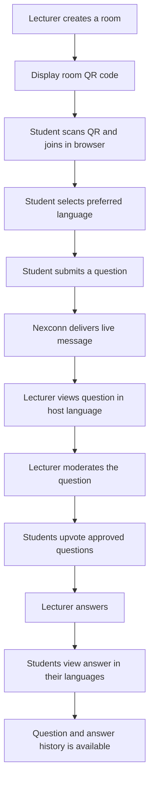
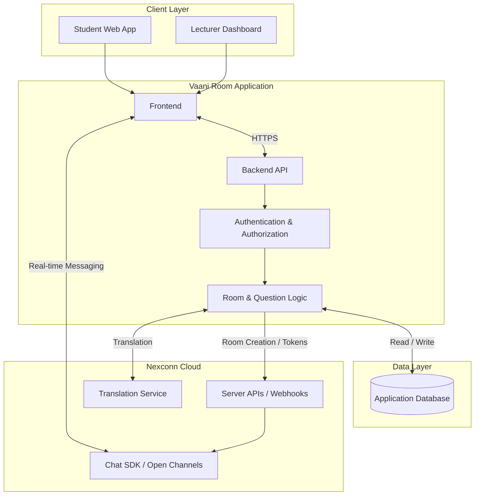

# Vaani Room

**Ask in your language. Understand in yours.**

Vaani Room is a proposed multilingual, browser-based live Q&A platform for classrooms, lectures, workshops, and events. Students join a room through a QR code, choose a preferred language, and submit questions. The lecturer views questions in the host language, moderates the queue, and responds. Students can then read answers in their chosen languages.

> **Project status:** In development. Phase 1 (host authentication, room
> creation, QR codes, public room lookup) is implemented and verified. Feature
> routes are being built in phases; the roadmap below marks what exists.
> Nothing is claimed as working until it is implemented and tested.
>
> - **[TEAM_LEAD.md](TEAM_LEAD.md)** — credential checklist, Nexconn Console
>   setup, integration seams, and production requirements.
> - **[docs/implementation-notes.md](docs/implementation-notes.md)** — actual
>   stack decisions, conventions, and phase log.

---

## Contents

- [The problem](#the-problem)
- [The solution](#the-solution)
- [How it works](#how-it-works)
- [Features](#features)
- [Who is it for?](#who-is-it-for)
- [System architecture](#system-architecture)
- [Technology](#technology)
- [Repository structure](#repository-structure)
- [Getting started](#getting-started)
- [Configuration and secrets](#configuration-and-secrets)
- [API routes](#api-routes)
- [Data model](#data-model)
- [Security, privacy, and reliability](#security-privacy-and-reliability)
- [Development roadmap](#development-roadmap)
- [Testing checklist](#testing-checklist)
- [Team handoff](#team-handoff)
- [Contributing](#contributing)

---

## The problem

In a multilingual classroom or event, a student may understand the subject but hesitate to ask a question because they are not comfortable speaking or writing in the lecturer's language. Live questions can also get repeated, become difficult to moderate, or disappear in a fast-moving discussion.

This creates a participation gap: the people who need clarification may be the least likely to ask for it.

## The solution

Vaani Room aims to make asking questions easier by separating the language a student uses from the language a lecturer uses.

- Students join from a browser using a room QR code; no dedicated app installation is intended to be necessary.
- Each student chooses a preferred language and submits a question in that language.
- The lecturer views the question in the configured host language.
- Students can browse and upvote questions, helping the lecturer prioritize the most useful ones.
- The lecturer answers in the host language, and students can view the answer in their selected language.

The goal is to make classroom participation more inclusive without making the lecturer manage separate language-specific discussions.

## How it works

1. **Create a room:** The lecturer creates a room and chooses the host language.
2. **Share the QR code:** Vaani Room provides a join link/QR code for the room.
3. **Join:** Students scan the QR code and open the room in a mobile or desktop browser.
4. **Choose a language:** Each student selects their preferred language.
5. **Ask:** Students submit questions. The live message is delivered through a Nexconn Chat SDK Open Channel.
6. **Translate:** The application uses Nexconn's translation capability so the lecturer can read questions in the host language.
7. **Moderate and prioritize:** The lecturer reviews questions; students can upvote them. Vaani Room stores vote records and moderation state in its own database.
8. **Answer:** The lecturer posts an answer to the room.
9. **Translate the answer:** Students view the answer in their preferred language, subject to translation availability and successful translation processing.
10. **Review history:** Vaani Room stores the application records needed to show recent questions and answers after a refresh or reconnect.



## Features

The following list separates the intended first release from ideas that should come later.

### Core MVP scope

- [x] Create a live room as a lecturer/host.
- [ ] Close a live room as a lecturer/host.
- [x] Create a host account and sign in with a DB-backed session.
- [x] Generate a room join link and QR code.
- [ ] Join a room from a mobile or desktop browser.
- [ ] Select a preferred language.
- [ ] Submit and receive live questions using Nexconn Chat SDK.
- [ ] Display the lecturer's questions in the configured host language using translation.
- [ ] Moderate questions (for example, approve, hide, or reject).
- [ ] Upvote questions with server-side validation and duplicate-vote prevention.
- [ ] Let the lecturer answer questions.
- [ ] Display answers in a student's selected language using translation.
- [ ] Save enough room, question, vote, and answer history to support refresh/rejoin.

### Planned enhancements

- [ ] Automatically group similar or duplicate questions.
- [ ] Pin important questions and answers.
- [ ] Export a room's Q&A history for the lecturer.
- [ ] Add richer moderation and abuse-reporting tools.
- [ ] Add room analytics and participation summaries.

> **Scope note:** Similar-question grouping is an enhancement, not a dependency for the first end-to-end demo. Build the basic join → ask → translate → moderate → vote → answer → translate flow first.

## Who is it for?

- **Students and participants:** People who want to ask questions in a language they are comfortable using.
- **Lecturers, teachers, and presenters:** Hosts who need a manageable live question queue.
- **Classrooms and educational institutions:** Groups that need a more inclusive way to collect questions during lectures.
- **Workshops, webinars, and events:** Hosts who want to collect and respond to questions from multilingual audiences.

## System architecture

The intended system has two browser experiences, a Vaani Room backend, Nexconn's real-time chat and translation capabilities, and an application database.



### Main component responsibilities

| Component | Responsibility |
|---|---|
| Student web app | QR joining, language selection, question submission, browsing, voting, and viewing answers. |
| Lecturer dashboard | Room creation, QR display, question queue, moderation, answering, and room controls. |
| Vaani Room backend | Room management, session/role authorization, voting rules, moderation state, and privileged server-side operations. |
| Nexconn Chat SDK | Live message transport between users connected to a room's Open Channel. |
| Nexconn translation | Asynchronous translation of message content for the configured viewer language. |
| Application database | Persistent records for rooms, participants, questions, votes, answers, and other application state. |

For the full design, component notes, workflows, database model, API responsibilities, deployment view, and implementation constraints, see **[docs/architecture.md](docs/architecture.md)**.

## Technology

The stack is now fixed for the MVP. Version numbers match `package.json`.

| Area | Choice | Status |
|---|---|---|
| Framework | Next.js 16.4.6 (App Router, Turbopack) | Implemented |
| UI | React 19.3.1, Tailwind CSS 4.3.5, local components | Implemented |
| Language | TypeScript 5.9.3 (strict) | Implemented |
| Backend | Next.js Route Handlers under `/api/*` | Health, auth, and rooms implemented; question routes in progress |
| Database | Prisma 6.19.3, SQLite locally, Postgres for production | Schema + migration implemented |
| Validation | Zod 4.6.7 | Implemented |
| Real-time messaging | Nexconn Chat SDK using Open Channels | Adapter contract implemented; integration pending credentials |
| Translation | Nexconn built-in translation | Adapter contract implemented; passthrough fallback in dev |
| QR codes | `qrcode` package | Implemented (server-generated join QR) |
| Hosting | HTTPS host with a long-lived Node runtime | Not yet selected |

Why these versions: Next 16 removes the PostCSS advisories present in Next 15;
Prisma 6 avoids a breaking major upgrade. Full reasoning is in
[docs/implementation-notes.md](docs/implementation-notes.md).

## Repository structure

The repository is organized like this:

```text
vaani-room/
├── docs/
│   ├── architecture.md           # Design authority
│   └── implementation-notes.md   # Stack decisions, conventions, phase log
├── prisma/
│   ├── schema.prisma             # Full ERD model
│   ├── migrations/               # Applied SQLite baseline
│   └── dev.db                    # Local only, gitignored
├── src/
│   ├── app/                      # Routes, layout, Route Handlers
│   │   ├── api/auth/             # Register, login, logout, me
│   │   ├── api/rooms/            # Create and list host rooms
│   │   ├── api/health/           # GET /api/health
│   │   ├── host/                 # Sign in/up, dashboard, room QR view
│   │   └── join/                 # Code entry and public room lookup
│   ├── components/               # Auth, host, join, brand, marketing, UI
│   ├── lib/                      # Domain, env, validation, API envelope
│   └── server/                   # Auth, rooms, chat/translation adapters
├── .env.example                  # Variable names and safe placeholders
├── TEAM_LEAD.md                  # Handoff and Nexconn integration guide
└── README.md
```

## Getting started

### Prerequisites

- **Node.js 20.9 or newer** (developed on Node 24).
- **npm 10 or newer**.
- No database server is required locally: SQLite ships with Prisma.

### Setup

```bash
# 1. Install dependencies
npm install

# 2. Create your local environment file
#    Copy .env.example to .env, then set SESSION_SECRET.
#    Generate a secret with:
node -e "console.log(require('crypto').randomBytes(48).toString('base64url'))"

# 3. Apply the database migration
npx prisma migrate dev

# 4. Start the app
npm run dev
```

Open `http://localhost:3000`. Create the first host account at
`http://localhost:3000/host/register`, then open the dashboard at `/host`.
Health check: `http://localhost:3000/api/health` returns
`{ "ok": true, "data": { "status": "ok", "database": "connected", … } }`.

On Windows, if the PowerShell execution policy blocks `npm`, use `npm.cmd` and
`npx.cmd` instead.

### Scripts

| Command | Purpose |
|---|---|
| `npm run dev` | Development server (Turbopack) |
| `npm run build` | Production build |
| `npm run start` | Serve the production build |
| `npm run typecheck` | `tsc --noEmit` |
| `npm run lint` | ESLint flat config |
| `npm run db:migrate` | `prisma migrate dev` |
| `npm run db:studio` | Prisma Studio |
| `npm run db:reset` | Reset the local database |

### Working without Nexconn credentials

The application runs with `NEXCONN_CHAT_PROVIDER="local"` and
`TRANSLATION_PROVIDER="passthrough"`:

- the local chat provider signs short-lived development tokens;
- the passthrough translator never fabricates a translation — it reports
  `unavailable` and the UI keeps the original text visible.

These are development scaffolding. See [TEAM_LEAD.md](TEAM_LEAD.md) for the
real integration.

## Configuration and secrets

All configuration lives in `.env` (gitignored). `.env.example` documents every
name with safe placeholders.

| Variable | Scope | Purpose |
|---|---|---|
| `APP_BASE_URL` | Server | Public origin used for join links and QR destinations |
| `DATABASE_URL` | Server | Prisma connection string (`file:./dev.db` locally) |
| `SESSION_SECRET` | Server only | Signs sessions and local transport tokens; required at runtime in production |
| `TRUSTED_PROXY_HEADER` | Server | Header set by your proxy for the client IP (`none`, `x-forwarded-for`, `x-real-ip`, `cf-connecting-ip`, `x-vercel-forwarded-for`) |
| `TRUSTED_PROXY_HOPS` | Server | Number of trusted proxies in front of the app; used to pick the right address from a forwarding chain |
| `NEXCONN_APP_KEY` | Server (safe to expose later) | Nexconn application identifier |
| `NEXCONN_APP_SECRET` | **Server only** | Privileged Nexconn API calls. **Never expose this to the browser.** |
| `NEXCONN_API_BASE_URL` | Server | Nexconn API base URL for the account region |
| `NEXCONN_WEBHOOK_SECRET` | Server only | Webhook signature verification |
| `NEXCONN_CHAT_PROVIDER` | Server | `local` (development) or `nexconn` |
| `TRANSLATION_PROVIDER` | Server | `passthrough`, `nexconn`, or `libretranslate` |
| `LIBRETRANSLATE_URL` / `LIBRETRANSLATE_API_KEY` | Server | Optional LibreTranslate endpoint and key |

`src/lib/env.ts` validates these at startup. Production startup fails without
`SESSION_SECRET`, and `NEXCONN_CHAT_PROVIDER=nexconn` requires the App Key and
Secret. Runtime-only checks run from `src/instrumentation.ts`, so a production
build does not need secrets that only exist in the deployed server. The browser
receives a short-lived user token from the backend; it never receives the App
Secret.

Only set `TRUSTED_PROXY_HEADER` when a proxy you control overwrites that header.
Otherwise leave it as `none`; the rate limiter then ignores client-supplied
forwarding headers and uses one conservative bucket for those requests.

- Keep real `.env` files out of Git; they are already in `.gitignore`.
- Commit `.env.example` with variable names and safe placeholders only.
- Rotate credentials if a secret is ever committed or shared accidentally.
- Use separate Nexconn applications and secrets for development and production.
- Never create a `NEXT_PUBLIC_*` variable for the App Secret, database URL,
  webhook secret, or session secret.

The full credential checklist and Console setup steps are in
[TEAM_LEAD.md](TEAM_LEAD.md).

## API routes

These are Vaani Room application routes. They are not Nexconn API endpoints.

Implemented in Phase 1:

| Method | Route | Purpose |
|---|---|---|
| `POST` | `/api/auth/register` | Create a host account and session |
| `POST` | `/api/auth/login` | Sign in a host |
| `POST` | `/api/auth/logout` | Clear the current session |
| `GET` | `/api/auth/me` | Return the current session user |
| `POST` | `/api/rooms` | Create a room, provision its channel, return QR + link |
| `GET` | `/api/rooms` | List the signed-in host's rooms and totals |
| `GET` | `/api/health` | Service and database health |

Planned next (see the roadmap):

| Method | Route | Purpose |
|---|---|---|
| `POST` | `/api/rooms` | Create a room and provision/associate its live channel. |
| `GET` | `/api/rooms/{joinCode}` | Fetch public details for a join page. |
| `POST` | `/api/rooms/{joinCode}/join` | Validate the room and return the participant session and chat connection details. |
| `GET` | `/api/rooms/{roomId}/history` | Load recent room history from the application database. |
| `GET` | `/api/rooms/{roomId}/questions` | Fetch questions visible to the requesting user. |
| `PATCH` | `/api/questions/{questionId}/moderation` | Approve, hide, or reject a question (host only). |
| `POST` | `/api/questions/{questionId}/votes` | Record a vote with duplicate-vote protection. |
| `DELETE` | `/api/questions/{questionId}/votes` | Remove the current participant's vote, if supported by the product. |
| `POST` | `/api/questions/{questionId}/answers` | Record/publish an answer (host only). |
| `PATCH` | `/api/rooms/{roomId}/close` | Close a room and reject new joins/submissions. |
| `POST` | `/api/webhooks/nexconn` | Receive configured Nexconn webhook events. |

## Data model

The proposed relational model includes these main entities:

| Entity | What it stores |
|---|---|
| `USERS` | Registered users or pseudonymous guest identities. |
| `ROOMS` | Host, join code, channel reference, host language, status, and timestamps. |
| `PARTICIPANTS` | Which user/session joined which room. |
| `QUESTIONS` | Original question, source language, message reference, translation cache (if used), and moderation state. |
| `VOTES` | A participant's vote for a question. Enforce uniqueness on `(question_id, user_id)`. |
| `ANSWERS` | Lecturer answer records associated with questions and chat message references. |
| `QUESTION_GROUPS` | Optional grouping of related questions; advanced feature. |

See the [Entity Relationship Diagram in the architecture document](docs/architecture.md#7-entity-relationship-diagram) for relationships and proposed fields.

The model is implemented in [`prisma/schema.prisma`](prisma/schema.prisma) with
the documented uniqueness constraints: one vote per `(question, user)`, unique
room join codes and channel IDs, idempotent `(room, clientNonce)` question
submissions, and unique webhook external IDs. See
[docs/implementation-notes.md](docs/implementation-notes.md) §5 for details.

## Security, privacy, and reliability

- **Keep the App Secret on the server.** Never put it in frontend code, client-side environment variables, or a public repository.
- **Enforce authorization on the backend.** A hidden button or client-side role value is not a security boundary.
- **Use stable, pseudonymous participant IDs** for guest sessions and vote deduplication. Anonymous display should not mean unrestricted or untraceable access.
- **Validate room membership and status** before accepting questions or votes.
- **Persist important application data.** Do not rely on a live chat channel as the only copy of questions, votes, or answers.
- **Handle asynchronous translation.** Show a pending state, retain the original text, and handle translation failures gracefully.
- **Handle reconnects.** Open Channel delivery is for active/online participants; load recent history from the Vaani Room backend when a participant rejoins.
- **Verify incoming webhooks** using the current Nexconn webhook security guidance and make processing idempotent.
- **Test language coverage.** Do not assume moderation or translation quality is identical for every language.
- **Check current plan limits and pricing** before load testing or running a large classroom pilot.

These are design requirements to implement and verify, not a claim that all controls are already present.

## Development roadmap

A practical implementation order is:

1. [x] Create a room and generate a QR join link.
2. [ ] Join the room from a second browser/device.
3. [ ] Implement backend-issued user tokens and secure Nexconn configuration.
4. [ ] Send and receive messages in a Nexconn Open Channel.
5. [ ] Store questions and answers in the application database.
6. [ ] Configure and test question translation for the host language.
7. [ ] Add host moderation controls.
8. [ ] Implement database-backed upvotes and duplicate-vote prevention.
9. [ ] Add lecturer answers and translation into each student's preferred language.
10. [ ] Restore recent room history after refresh/rejoin.
11. [ ] Polish responsive UI, error states, and room closure.
12. [ ] Consider automatic similar-question grouping after the core flow is stable.

## Testing checklist

Use this checklist before presenting or submitting the project:

- [x] A lecturer can create a room.
- [ ] A QR code opens the correct room on a phone.
- [ ] A student can join without installing a dedicated app.
- [ ] A student can select a preferred language.
- [ ] Two or more connected clients can exchange live messages.
- [ ] A question in a selected Indian language can be submitted and translated for the lecturer in a tested language pair.
- [ ] The lecturer can approve, hide, or reject a question.
- [ ] Multiple student sessions can vote on a question.
- [ ] A participant cannot vote repeatedly on the same question using the same stable session identity.
- [ ] The lecturer can publish an answer.
- [ ] The student can view the answer in their selected language.
- [ ] The original message remains available if translation fails.
- [ ] Refreshing or reconnecting restores recent history from the application database.
- [ ] A closed room rejects new joins and submissions.
- [ ] No App Secret or database credential is exposed in browser code or Git history.

## Team handoff

The team lead owns the Nexconn account, credentials, Console configuration, and
deployment. Everything they need is collected in **[TEAM_LEAD.md](TEAM_LEAD.md)**:

- required environment variables and which ones are secret;
- the exact values, SDK details, token API, webhook contract, translation
  mapping, and plan limits still needed from Nexconn;
- Console setup steps;
- where each integration plugs into the codebase;
- security and production checklists.

Engineering decisions and the phase log live in
[docs/implementation-notes.md](docs/implementation-notes.md).

## Contributing

Contributions from the project team are welcome. To keep changes reviewable:

1. Create a branch for each feature or fix.
2. Keep pull requests focused on one change.
3. Update the relevant documentation when API contracts, data models, workflows, or architecture change.
4. Test the complete affected flow before marking work complete.
5. Never commit secrets, access tokens, personal participant data, or real environment files.

Suggested branch naming:

```text
feature/qr-room-joining
feature/live-chat
feature/question-translation
feature/question-voting
fix/reconnect-history
```

---

**Vaani Room — making every question easier to ask, and every answer easier to understand.**
