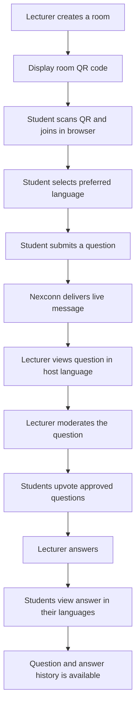
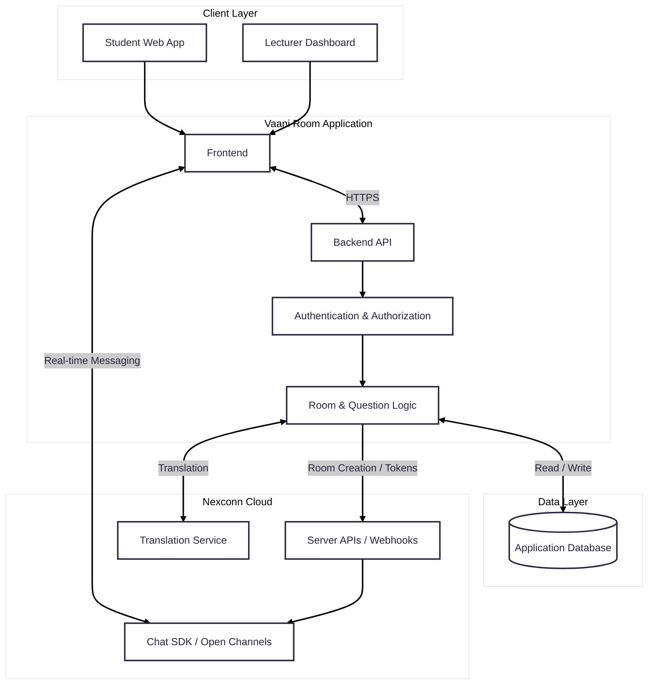

# Vaani Room

**Ask in your language. Understand in yours.**

Vaani Room is a proposed multilingual, browser-based live Q&A platform for classrooms, lectures, workshops, and events. Students join a room through a QR code, choose a preferred language, and submit questions. The lecturer views questions in the host language, moderates the queue, and responds. Students can then read answers in their chosen languages.

> **Project status:** Hackathon project in development. This README describes the intended product and proposed design. Features should not be considered implemented until they are built and tested in the project.

---

## Contents

- [The problem](#the-problem)
- [The solution](#the-solution)
- [How it works](#how-it-works)
- [Features](#features)
- [Who is it for?](#who-is-it-for)
- [System architecture](#system-architecture)
- [Technology](#technology)
- [Repository structure](#repository-structure)
- [Getting started](#getting-started)
- [Configuration and secrets](#configuration-and-secrets)
- [Proposed API](#proposed-api)
- [Data model](#data-model)
- [Security, privacy, and reliability](#security-privacy-and-reliability)
- [Development roadmap](#development-roadmap)
- [Testing checklist](#testing-checklist)
- [Contributing](#contributing)

---

## The problem

In a multilingual classroom or event, a student may understand the subject but hesitate to ask a question because they are not comfortable speaking or writing in the lecturer's language. Live questions can also get repeated, become difficult to moderate, or disappear in a fast-moving discussion.

This creates a participation gap: the people who need clarification may be the least likely to ask for it.

## The solution

Vaani Room aims to make asking questions easier by separating the language a student uses from the language a lecturer uses.

- Students join from a browser using a room QR code; no dedicated app installation is intended to be necessary.
- Each student chooses a preferred language and submits a question in that language.
- The lecturer views the question in the configured host language.
- Students can browse and upvote questions, helping the lecturer prioritize the most useful ones.
- The lecturer answers in the host language, and students can view the answer in their selected language.

The goal is to make classroom participation more inclusive without making the lecturer manage separate language-specific discussions.

## How it works

1. **Create a room:** The lecturer creates a room and chooses the host language.
2. **Share the QR code:** Vaani Room provides a join link/QR code for the room.
3. **Join:** Students scan the QR code and open the room in a mobile or desktop browser.
4. **Choose a language:** Each student selects their preferred language.
5. **Ask:** Students submit questions. The live message is delivered through a Nexconn Chat SDK Open Channel.
6. **Translate:** The application uses Nexconn's translation capability so the lecturer can read questions in the host language.
7. **Moderate and prioritize:** The lecturer reviews questions; students can upvote them. Vaani Room stores vote records and moderation state in its own database.
8. **Answer:** The lecturer posts an answer to the room.
9. **Translate the answer:** Students view the answer in their preferred language, subject to translation availability and successful translation processing.
10. **Review history:** Vaani Room stores the application records needed to show recent questions and answers after a refresh or reconnect.



## Features

The following list separates the intended first release from ideas that should come later.

### Core MVP scope

- [ ] Create and close a live room as a lecturer/host.
- [ ] Generate a room join link and QR code.
- [ ] Join a room from a mobile or desktop browser.
- [ ] Select a preferred language.
- [ ] Submit and receive live questions using Nexconn Chat SDK.
- [ ] Display the lecturer's questions in the configured host language using translation.
- [ ] Moderate questions (for example, approve, hide, or reject).
- [ ] Upvote questions with server-side validation and duplicate-vote prevention.
- [ ] Let the lecturer answer questions.
- [ ] Display answers in a student's selected language using translation.
- [ ] Save enough room, question, vote, and answer history to support refresh/rejoin.

### Planned enhancements

- [ ] Automatically group similar or duplicate questions.
- [ ] Pin important questions and answers.
- [ ] Export a room's Q&A history for the lecturer.
- [ ] Add richer moderation and abuse-reporting tools.
- [ ] Add room analytics and participation summaries.

> **Scope note:** Similar-question grouping is an enhancement, not a dependency for the first end-to-end demo. Build the basic join → ask → translate → moderate → vote → answer → translate flow first.

## Who is it for?

- **Students and participants:** People who want to ask questions in a language they are comfortable using.
- **Lecturers, teachers, and presenters:** Hosts who need a manageable live question queue.
- **Classrooms and educational institutions:** Groups that need a more inclusive way to collect questions during lectures.
- **Workshops, webinars, and events:** Hosts who want to collect and respond to questions from multilingual audiences.

## System architecture

The intended system has two browser experiences, a Vaani Room backend, Nexconn's real-time chat and translation capabilities, and an application database.



### Main component responsibilities

| Component | Responsibility |
|---|---|
| Student web app | QR joining, language selection, question submission, browsing, voting, and viewing answers. |
| Lecturer dashboard | Room creation, QR display, question queue, moderation, answering, and room controls. |
| Vaani Room backend | Room management, session/role authorization, voting rules, moderation state, and privileged server-side operations. |
| Nexconn Chat SDK | Live message transport between users connected to a room's Open Channel. |
| Nexconn translation | Asynchronous translation of message content for the configured viewer language. |
| Application database | Persistent records for rooms, participants, questions, votes, answers, and other application state. |

For the full design, component notes, workflows, database model, API responsibilities, deployment view, and implementation constraints, see **[docs/architecture.md](docs/architecture.md)**.

## Technology

The architecture currently identifies Nexconn Chat SDK as the real-time messaging layer. The exact frontend framework, backend framework, database product, and hosting provider should be recorded here once the team selects and implements them.

| Area | Current direction | Status |
|---|---|---|
| User interface | Responsive browser-based web app / PWA | Proposed |
| Real-time messaging | Nexconn Chat SDK using Open Channels | Planned integration |
| Translation | Nexconn built-in translation capability | Planned integration; requires Console configuration and testing |
| Backend | Server-side API for room management, authorization, votes, moderation, and Nexconn server operations | Framework not yet specified |
| Database | Relational database for persistent application records | Product not yet specified |
| Hosting | Frontend and backend hosting with HTTPS | Provider not yet specified |

Update this table when implementation choices are final. Do not list a technology as part of the stack merely because it appears in an example or an early diagram.

## Repository structure

The repository may be organized like this as the project grows. Adjust it to match the actual codebase:

```text
vaani-room/
├── docs/
│   ├── architecture.md
│   ├── use-cases.md              # Optional: detailed use-case notes
│   └── api-design.md             # Optional: API request/response contracts
├── public/                       # Static assets, including a logo if added
├── src/                          # Application source code (if using this layout)
├── .env.example                  # Names of required environment variables; no secrets
├── .gitignore
└── README.md
```

This is a suggested structure, not a requirement. Frameworks such as Next.js, Vite, or other tooling may generate a different source layout.

## Getting started

### Prerequisites

The exact prerequisites depend on the frameworks and database selected by the team. Before adding setup commands here, document the versions actually used by the repository, such as:

- Required runtime and version.
- Package manager and version.
- Database engine and local/cloud setup method.
- Nexconn account, application, and Chat SDK credentials/configuration.

### Setup

The framework-specific install and run commands have not been finalized in this design document. Once the application scaffold is committed, replace this section with the exact verified commands. A typical setup sequence will be:

1. Clone the repository.
2. Install dependencies using the repository's package manager.
3. Create a local environment file from `.env.example`.
4. Configure the database and apply migrations, if applicable.
5. Configure the Nexconn application and server-side credentials.
6. Start the backend and frontend using the project's documented scripts.

Do not copy generic commands from another framework; use the scripts defined in this repository's `package.json`, Makefile, or equivalent project configuration.

## Configuration and secrets

The application will need configuration for its chosen database and Nexconn app. The names below are suggested application environment variable names; align them with the actual implementation.

| Suggested variable | Where it belongs | Purpose |
|---|---|---|
| `NEXCONN_APP_KEY` | Client configuration, if required by the SDK; may also be exposed through a safe public config endpoint | Identifies the Nexconn application. |
| `NEXCONN_APP_SECRET` | Backend only | Used for privileged server-side Nexconn operations. **Never expose this to the browser.** |
| `DATABASE_URL` | Backend only | Database connection string. |
| `APP_BASE_URL` | Backend / deployment config | Public base URL used to construct room links and QR destinations. |

Depending on the final SDK integration, the client may also receive a short-lived or user-specific Nexconn access token from the backend. Do not hardcode tokens or secrets in source files.

- Keep real `.env` files out of Git; add them to `.gitignore`.
- Commit `.env.example` with variable names and safe placeholder values only.
- Rotate credentials if a secret is ever committed or shared accidentally.
- Use separate credentials and configuration for local development and production.

## Proposed API

These are Vaani Room application routes proposed in the architecture. They are not Nexconn API endpoints. Update them to match the implemented backend.

| Method | Route | Purpose |
|---|---|---|
| `POST` | `/api/rooms` | Create a room and provision/associate its live channel. |
| `GET` | `/api/rooms/{joinCode}` | Fetch public details for a join page. |
| `POST` | `/api/rooms/{joinCode}/join` | Validate the room and return the participant session and chat connection details. |
| `GET` | `/api/rooms/{roomId}/history` | Load recent room history from the application database. |
| `GET` | `/api/rooms/{roomId}/questions` | Fetch questions visible to the requesting user. |
| `PATCH` | `/api/questions/{questionId}/moderation` | Approve, hide, or reject a question (host only). |
| `POST` | `/api/questions/{questionId}/votes` | Record a vote with duplicate-vote protection. |
| `DELETE` | `/api/questions/{questionId}/votes` | Remove the current participant's vote, if supported by the product. |
| `POST` | `/api/questions/{questionId}/answers` | Record/publish an answer (host only). |
| `PATCH` | `/api/rooms/{roomId}/close` | Close a room and reject new joins/submissions. |
| `POST` | `/api/webhooks/nexconn` | Receive configured Nexconn webhook events. |

## Data model

The proposed relational model includes these main entities:

| Entity | What it stores |
|---|---|
| `USERS` | Registered users or pseudonymous guest identities. |
| `ROOMS` | Host, join code, channel reference, host language, status, and timestamps. |
| `PARTICIPANTS` | Which user/session joined which room. |
| `QUESTIONS` | Original question, source language, message reference, translation cache (if used), and moderation state. |
| `VOTES` | A participant's vote for a question. Enforce uniqueness on `(question_id, user_id)`. |
| `ANSWERS` | Lecturer answer records associated with questions and chat message references. |
| `QUESTION_GROUPS` | Optional grouping of related questions; advanced feature. |

See the [Entity Relationship Diagram in the architecture document](docs/architecture.md#7-entity-relationship-diagram) for relationships and proposed fields.

## Security, privacy, and reliability

- **Keep the App Secret on the server.** Never put it in frontend code, client-side environment variables, or a public repository.
- **Enforce authorization on the backend.** A hidden button or client-side role value is not a security boundary.
- **Use stable, pseudonymous participant IDs** for guest sessions and vote deduplication. Anonymous display should not mean unrestricted or untraceable access.
- **Validate room membership and status** before accepting questions or votes.
- **Persist important application data.** Do not rely on a live chat channel as the only copy of questions, votes, or answers.
- **Handle asynchronous translation.** Show a pending state, retain the original text, and handle translation failures gracefully.
- **Handle reconnects.** Open Channel delivery is for active/online participants; load recent history from the Vaani Room backend when a participant rejoins.
- **Verify incoming webhooks** using the current Nexconn webhook security guidance and make processing idempotent.
- **Test language coverage.** Do not assume moderation or translation quality is identical for every language.
- **Check current plan limits and pricing** before load testing or running a large classroom pilot.

These are design requirements to implement and verify, not a claim that all controls are already present.

## Development roadmap

A practical implementation order is:

1. [ ] Create a room and generate a QR join link.
2. [ ] Join the room from a second browser/device.
3. [ ] Implement backend-issued user tokens and secure Nexconn configuration.
4. [ ] Send and receive messages in a Nexconn Open Channel.
5. [ ] Store questions and answers in the application database.
6. [ ] Configure and test question translation for the host language.
7. [ ] Add host moderation controls.
8. [ ] Implement database-backed upvotes and duplicate-vote prevention.
9. [ ] Add lecturer answers and translation into each student's preferred language.
10. [ ] Restore recent room history after refresh/rejoin.
11. [ ] Polish responsive UI, error states, and room closure.
12. [ ] Consider automatic similar-question grouping after the core flow is stable.

## Testing checklist

Use this checklist before presenting or submitting the project:

- [ ] A lecturer can create a room.
- [ ] A QR code opens the correct room on a phone.
- [ ] A student can join without installing a dedicated app.
- [ ] A student can select a preferred language.
- [ ] Two or more connected clients can exchange live messages.
- [ ] A question in a selected Indian language can be submitted and translated for the lecturer in a tested language pair.
- [ ] The lecturer can approve, hide, or reject a question.
- [ ] Multiple student sessions can vote on a question.
- [ ] A participant cannot vote repeatedly on the same question using the same stable session identity.
- [ ] The lecturer can publish an answer.
- [ ] The student can view the answer in their selected language.
- [ ] The original message remains available if translation fails.
- [ ] Refreshing or reconnecting restores recent history from the application database.
- [ ] A closed room rejects new joins and submissions.
- [ ] No App Secret or database credential is exposed in browser code or Git history.

## Contributing

Contributions from the project team are welcome. To keep changes reviewable:

1. Create a branch for each feature or fix.
2. Keep pull requests focused on one change.
3. Update the relevant documentation when API contracts, data models, workflows, or architecture change.
4. Test the complete affected flow before marking work complete.
5. Never commit secrets, access tokens, personal participant data, or real environment files.

Suggested branch naming:

```text
feature/qr-room-joining
feature/live-chat
feature/question-translation
feature/question-voting
fix/reconnect-history
```

---

**Vaani Room — making every question easier to ask, and every answer easier to understand.**
